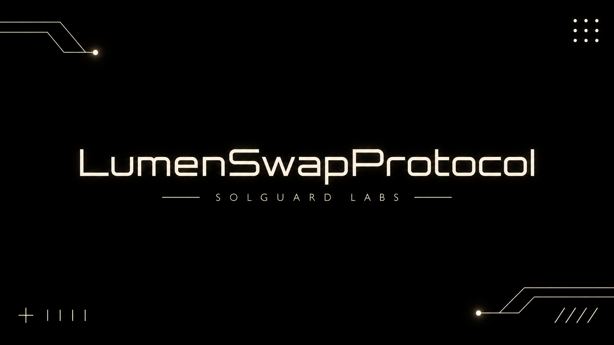
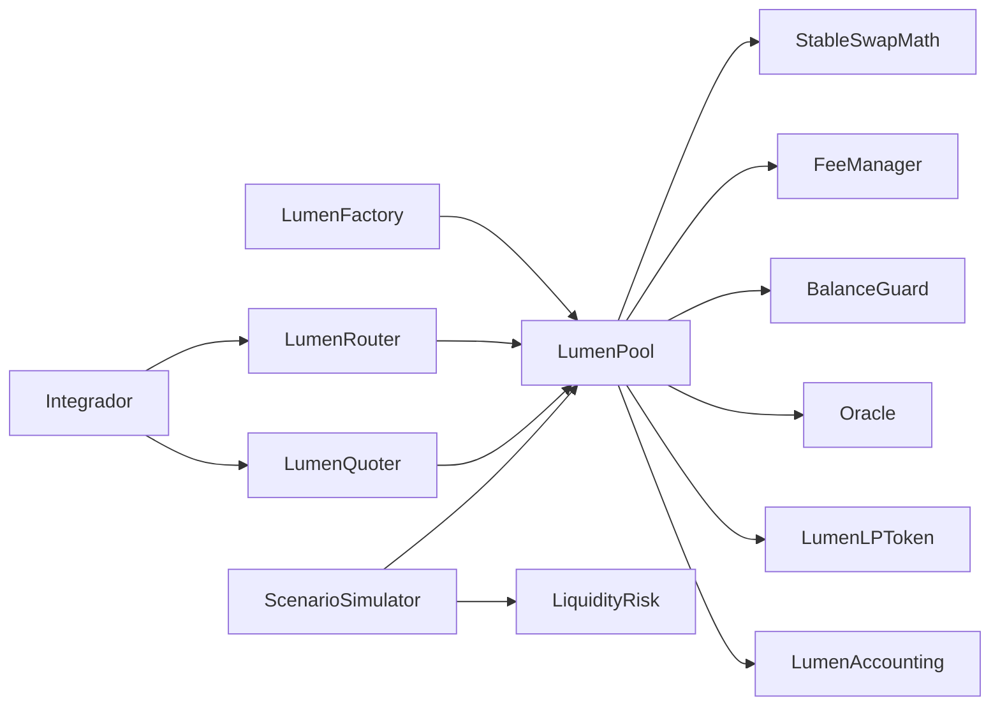
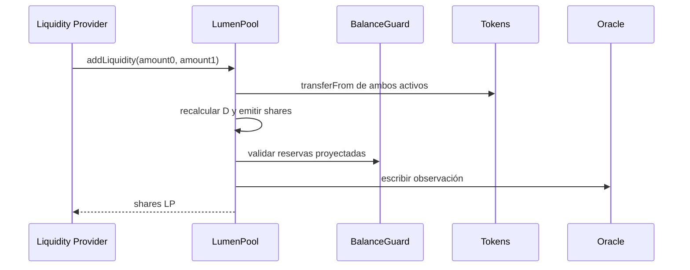

# LumenSwapProtocol



LumenSwapProtocol es un AMM stable-swap de dos activos implementado en Solidity
0.8.26. El sistema combina curva amplificada, participaciones LP, fees
separadas, oráculo acumulativo, límites de balance y escenarios deterministas de
liquidez.

## Capacidades

- Creación canónica de pools mediante factory y deployer dedicado.
- Liquidez proporcional, a un token y por importes específicos.
- Swaps exact-input con fee dinámica por tamaño y desequilibrio.
- Contabilidad separada de principal, fees LP y fees de protocolo.
- Checkpoints de fee por titular y claim independiente de principal.
- Guard de reservas, ratio y tamaño máximo de salida.
- Oráculo circular de precios acumulados.
- Quoteadores, lens, router y simulador de escenarios.
- Stress de liquidez por activo con cobertura, buffer y retención de `D`.

## Arquitectura



El pool es la única frontera de custodia. Router, lens, quoter y simulador no
retienen activos; leen o encaminan operaciones hacia una dirección de pool
concreta.

## Curva estable

Para dos reservas virtuales `x₀` y `x₁`, la librería itera el invariante `D` de
Curve-style StableSwap con una amplificación normalizada `A·n`:

```text
S   = x₀ + x₁
Dₚ  = D³ / (x₀ · x₁ · n²)

D_next = ((Ann · S + Dₚ · n) · D)
         / ((Ann - 1) · D + (n + 1) · Dₚ)
```

La iteración finaliza cuando `|D_next - D| <= 1`. Las operaciones que no
convergen revierten, por lo que nunca publican reservas parciales.

## Ciclo de liquidez



Las reservas virtuales representan principal activo. El balance bruto añade
liabilities de fees:

```text
grossᵢ = virtualᵢ + pendingLPFeeᵢ + protocolFeeᵢ
```

Esta identidad se valida en pruebas y puede consultarse con `LumenPoolLens`.

## Stress de liquidez

`LumenLiquidityRisk` calcula por token:

```text
available = max(virtual - reserveFloor, 0)
eligible  = available × (1 - reserveHaircut)
uses      = virtual × redemptionShock + feeLiabilities
coverage  = eligible / uses
buffer    = max(uses × minimumCoverage - eligible, 0)
```

El reporte agrega el peor coverage, el buffer total, el skew proyectado y la
retención del invariante tras el shock.

| Escenario | Redención | Haircut | Coverage mínimo | Skew máximo |
| --------- | --------: | ------: | --------------: | ----------: |
| Operativo |      10 % |     5 % |           120 % |        25 % |
| Severo    |      40 % |    25 % |           150 % |        40 % |

Consulte [Riesgo de liquidez](./docs/riesgo-liquidez.md) para los supuestos y el
semáforo completo.

## Uso local

Requisitos:

- Foundry estable con Solidity 0.8.26.
- Node.js 24 o superior.

```bash
npm ci
make verify
make release-check
```

Equivalente sin Make:

```bash
forge fmt --check
forge build --no-lint
forge test
npm run ci
```

## Despliegue de referencia

```bash
forge script script/DeployLumen.s.sol \
  --rpc-url "$RPC_URL" \
  --broadcast
```

La configuración de un pool debe fijar token0, token1, owner, fee recipient, fee
manager, balance guard, oracle y amplificación. El despliegue es válido solo si
ambas direcciones de token son distintas y no nulas.

## Integración

Ejemplo de quote exact-input:

```solidity
SwapQuote memory quote = ILumenPool(pool).quoteExactInput(tokenIn, amountIn);
require(quote.amountOut >= minAmountOut, "SLIPPAGE");
```

Toda transacción debe incluir protección de precio y deadline. No se recomienda
construir importes mínimos a partir de eventos; use una lectura de estado en el
mismo bloque de preparación.

## Documentación

- [Arquitectura](./docs/arquitectura.md)
- [Modelo económico](./docs/modelo-economico.md)
- [Riesgo de liquidez](./docs/riesgo-liquidez.md)
- [Operación](./docs/operacion.md)
- [Integración](./docs/integracion.md)
- [Política de seguridad](./SECURITY.md)
- [Contribución](./CONTRIBUTING.md)
- [Historial de cambios](./CHANGELOG.md)

## Compatibilidad

- Solidity 0.8.26 y EVM Cancun.
- Foundry 1.8 o superior.
- Linux y Windows en integración continua.

La versión estable es `v1.0.0` y se publica desde la rama `production`.
