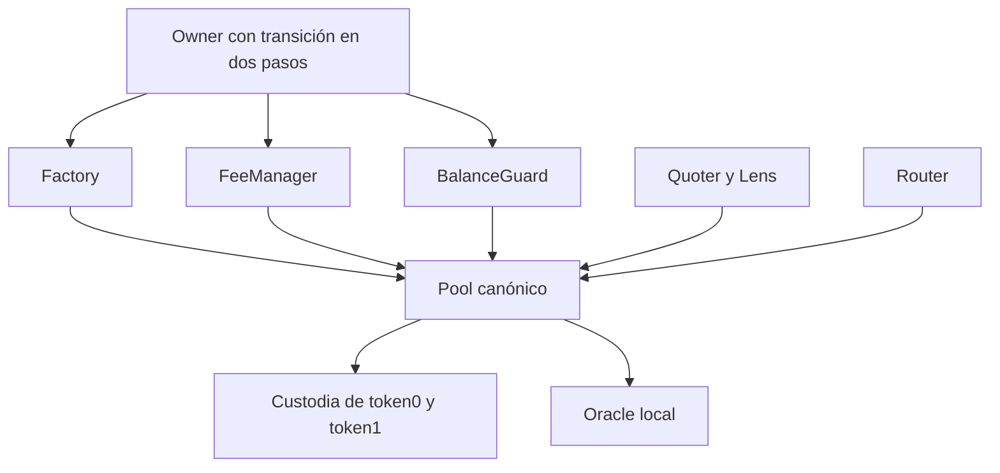
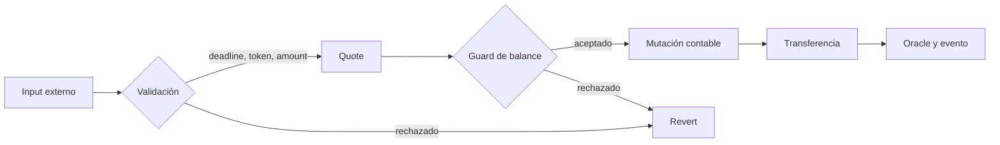
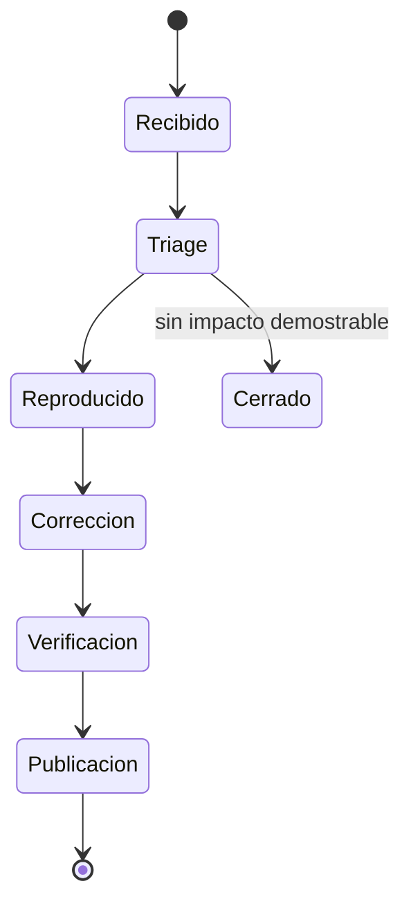

# Política de seguridad

## Versiones mantenidas

| Versión   | Estado      |
| --------- | ----------- |
| `1.0.x`   | Mantenida   |
| `< 1.0.0` | Sin soporte |

## Modelo de confianza

LumenSwapProtocol separa custodia, cálculo, parámetros y observabilidad. La
factory controla el origen de pools; cada pool mantiene reservas y shares; los
módulos auxiliares solo cotizan, encaminan o publican métricas.



El owner puede actualizar destinatarios y módulos autorizados, pero no puede
transferir reservas por una ruta administrativa. Las salidas de activos pasan
por una operación económica del pool y sus controles de balance.

## Invariantes

- `physicalᵢ == grossᵢ` después de cada operación completada.
- `grossᵢ == virtualᵢ + pendingLPFeeᵢ + protocolFeeᵢ`.
- Las fees de protocolo no forman parte del principal LP.
- La emisión inicial bloquea `MINIMUM_LIQUIDITY` de forma permanente.
- Los swaps válidos mantienen o incrementan `D` después de fees.
- Una transferencia fallida revierte toda la actualización contable.
- Los límites del guard se evalúan sobre reservas proyectadas.
- Los claims consumen el checkpoint del titular antes de transferir.

## Fronteras críticas



Las revisiones deben priorizar:

- convergencia y redondeos de `StableSwapMath`;
- relación entre variación de `D`, emisión y quema de shares;
- separación de principal y liabilities de fees;
- interacción entre transferencias externas y reentrancy guard;
- actualizaciones de fee manager, guard, oracle y fee recipient;
- límites de reserva bajo secuencias de operaciones encadenadas.

## Validación obligatoria

```bash
npm ci
forge fmt --check
forge build --no-lint
FOUNDRY_PROFILE=ci forge test
npm run ci
```

Los cambios de matemática, accounting, shares, fees o guard requieren una prueba
nominal, una de borde y una que preserve reconciliación física.

## Reporte responsable

No publique detalles técnicos antes de que el equipo confirme recepción. Un
reporte útil incluye:

- commit y componente afectados;
- secuencia mínima y determinista;
- precondiciones económicas;
- impacto cuantificado por activo y por share;
- estado esperado y observado;
- propuesta de remediación y prueba de regresión.

No incluya claves privadas, credenciales, datos de terceros ni transacciones en
redes con valor.

## Respuesta



La severidad se determina por pérdida máxima, precondiciones, repetibilidad y
capacidad de atravesar límites de balance. La publicación se realiza solo tras
validar el commit final en `main`, `production` y el tag firmado o anotado.

## Fuera de alcance

- Frontends e indexadores externos.
- Bridges, custodios u oráculos de terceros.
- Tokens con rebase o fee-on-transfer.
- Pérdidas debidas únicamente a slippage aceptado por el usuario.
- Uso de contratos modificados o pools no creados por la factory canónica.
