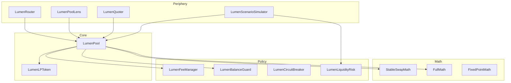
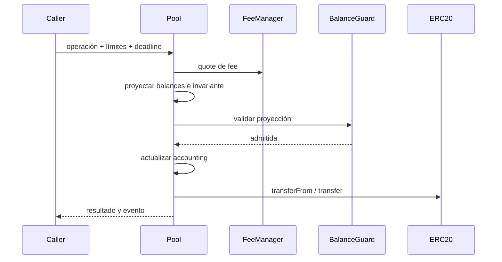

# Arquitectura

## Dominios

LumenSwapProtocol divide responsabilidades en cinco dominios:

1. custodia y settlement en `LumenPool`;
2. matemática pura en `libraries/`;
3. política parametrizable en `fees/` y `risk/`;
4. despliegue canónico en `LumenFactory` y `LumenPoolDeployer`;
5. integración de solo lectura en `periphery/`.

## Estado del pool

Cada pool almacena:

- direcciones inmutables de token0 y token1;
- extremos y tiempo de la amplificación programada;
- balances brutos y virtuales por token;
- liabilities de fees LP y de protocolo;
- crecimiento acumulado de fees por share;
- `cachedInvariant` y liquidez bloqueada;
- módulos operativos actualizables por owner.

El orden de estado evita depender del balance ERC-20 como fuente única. Los
tokens físicos se reconcilian contra el libro interno al finalizar cada flujo.
La rampa de amplificación cambia una política matemática, no transfiere custodia
ni altera por sí misma las reservas físicas o virtuales.

## Settlement

Una operación revertida no deja checkpoints parciales. `nonReentrant` cubre las
rutas con transferencia externa y `whenNotPaused` bloquea mutaciones durante una
incidencia operativa.

## Extensión

Los módulos auxiliares deben permanecer sin custodia. Para añadir una vista:

1. leer estado a través de `ILumenPool`;
2. usar librerías puras para cálculos;
3. devolver structs autocontenidos;
4. no escribir en el pool ni conservar aprobaciones.
