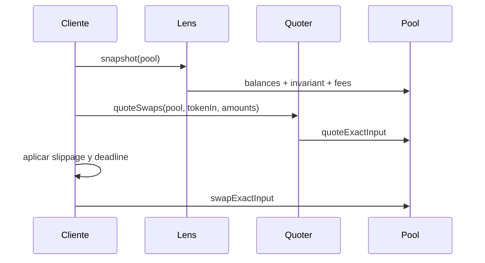

# Integración

## Lecturas recomendadas

Use `LumenPoolLens` para snapshots y `LumenQuoter` para rutas de usuario. Las
lecturas deben ejecutarse sobre el mismo bloque para evitar mezclar estados.



## Slippage

Para un swap, derive `minAmountOut` de `quote.amountOut` y una tolerancia en
ppm:

```text
minAmountOut = quote.amountOut × (1_000_000 - tolerancePpm) / 1_000_000
```

Para aportar liquidez use `minShares`; para retirar importes específicos use
`maxShares`. El deadline debe ser corto y explícito. Durante una rampa de
amplificación, vuelva a solicitar el quote después de cada cambio de bloque:
`amplification()` depende del tiempo de ejecución.

## Eventos

Los indexadores deben consumir:

- `LiquidityAdded` y `LiquidityRemoved` para actividad LP;
- `Swap` para volumen y fees;
- `LPFeesClaimed` y `ProtocolFeesCollected` para liabilities;
- cambios de fee manager, guard y fee recipient para configuración.
- `AmplificationRampScheduled` y `AmplificationRampStopped` para gobierno de la
  curva; contraste los eventos con `amplificationRamp()`.

Un evento no sustituye la lectura de estado. Ante reorganización, reconstruya
desde el último bloque finalizado y confirme balances contra el pool.

## Manejo de errores

Los errores custom distinguen token no válido, deadline, liquidez, slippage,
shares y transferencias. El cliente debe mostrar el límite fallido sin
reintentar automáticamente con controles más laxos.

## Direcciones

No confíe en una dirección entregada por un tercero. Verifique el par contra
`LumenFactory.getPool` y confirme token0/token1 en el contrato resultante.
