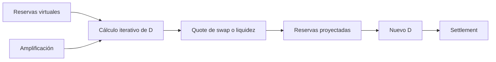

# Modelo económico

## Unidades

El pool opera con unidades mínimas de cada ERC-20. La curva no normaliza
decimales, por lo que un par productivo debe usar activos con escalas
compatibles o adaptadores externos explícitos.

## Invariante amplificado

El parámetro `amplification` controla la curvatura cerca del equilibrio. Un
valor alto reduce price impact en la zona central, pero concentra la
sensibilidad al aproximarse a reservas extremas.



Las divisiones usan `FullMath.mulDiv` cuando intervienen productos de 256 bits.
Los redondeos favorecen la permanencia de reserva: un swap resta una unidad del
output calculado y las shares mínimas se validan antes del settlement.

## Shares LP

En la primera aportación:

```text
shares = D_after - MINIMUM_LIQUIDITY
```

La fracción mínima se acuña a `DEAD_SHARES`. En aportaciones posteriores:

```text
shares = totalSupply × (D_after - D_before) / D_before
```

Una salida proporcional distribuye principal según:

```text
amountᵢ = shares × virtualᵢ / totalSupply
```

Las salidas a un token resuelven la reserva restante sobre el objetivo de `D`.

## Fees

La fee total de swap combina base, tamaño y desequilibrio, limitada por
`maxFeePpm`. Después se separa:

```text
protocolFee = totalFee × adminFeePpm / 1_000_000
lpFee       = totalFee - protocolFee
```

La fee LP incrementa el acumulador global por share. Cada titular materializa su
parte cuando transfiere shares, aporta, retira o reclama.

## Contabilidad

```text
active principal = virtual0 + virtual1
LP liabilities   = pendingLPFee0 + pendingLPFee1
admin liabilities= protocolFee0 + protocolFee1
gross assets     = active principal + liabilities
```

El NAV de principal y el valor de fees se publican por separado. Esto permite
reconciliar activos sin confundir obligaciones reclamables con liquidez activa.

## Ejemplo

Con 10 millones de unidades por lado, 20 millones de `D` aproximado y una
entrada adicional balanceada de 1 millón por lado, el delta de `D` es cercano a
2 millones. Si el supply previo es 20 millones, la emisión esperada es cercana a
2 millones de shares, sujeta al redondeo de la curva.
