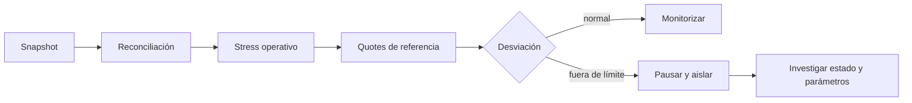

# Operación

## Preflight

Antes de aceptar un pool en un entorno operativo:

```bash
npm ci
make verify
make release-check
```

Verifique además que:

- el pool fue creado por la factory esperada;
- token0 y token1 coinciden con el par aprobado;
- owner, fee recipient, fee manager, guard y oracle son los previstos;
- `cachedInvariant` y el cálculo del lens se interpretan junto con el estado de
  la rampa de amplificación;
- los balances físicos reconcilian con `gross0` y `gross1`.

## Runbook diario



Métricas mínimas:

| Señal                  | Uso                                                 |
| ---------------------- | --------------------------------------------------- |
| `invariantDrift`       | Diferencia entre `cachedInvariant` y cálculo actual |
| `grossMatchesPhysical` | Reconciliación de custodia                          |
| `liabilitiesCovered`   | Cobertura de fees                                   |
| `worstCoveragePpm`     | Cobertura bajo shock                                |
| `requiredBuffer`       | Capital operativo adicional                         |
| `projectedSkewPpm`     | Concentración entre lados                           |
| `amplification()`      | Parámetro efectivo del bloque                       |
| `amplificationRamp()`  | Extremos y ventana de la transición programada      |

Una rampa puede producir `invariantDrift` sin movimientos de reservas, porque el
lens recalcula `D` con el parámetro efectivo y el checkpoint se escribe en el
settlement. Registre ambas lecturas y el bloque exacto; la reconciliación de
custodia y los límites de shares siguen siendo verificaciones separadas.

## Incidencia

1. pausar el pool sin cambiar parámetros;
2. fijar bloque, estado y balances físicos;
3. reproducir quotes desde el snapshot;
4. separar principal, fee LP y fee de protocolo;
5. ejecutar escenarios operativo y severo;
6. documentar toda transición administrativa;
7. reanudar solo después de reconciliación y revisión independiente.

## Release

La rama `production`, el tag `v2.0.0` y `main` deben resolver al mismo commit.
Los checks de Foundry y Node deben estar verdes en los tres refs. La publicación
incluye únicamente artefactos de código fuente y documentación versionada.
