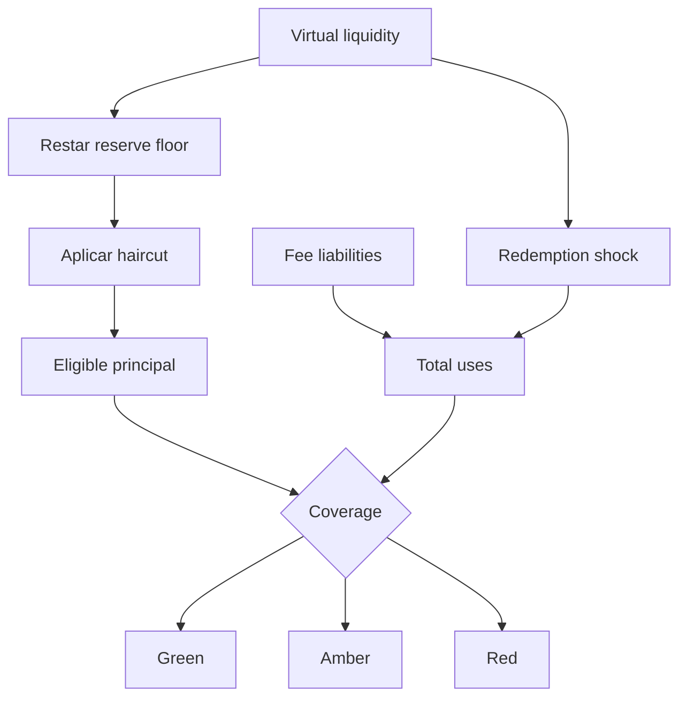

# Riesgo de liquidez

## Objetivo

El módulo `LumenLiquidityRisk` estima si cada reserva puede absorber redenciones
y liabilities de fee después de aplicar floors y haircuts. No ejecuta cambios;
produce una vista determinista para operadores y sistemas de límites.

## Cascada



Los campos principales son:

| Campo                   | Interpretación                                  |
| ----------------------- | ----------------------------------------------- |
| `eligiblePrincipal`     | Principal utilizable después de floor y haircut |
| `stressedOutflow`       | Salida aplicada sobre la reserva virtual        |
| `totalUses`             | Outflow más fees reclamables                    |
| `coveragePpm`           | Recursos elegibles por unidad de uso            |
| `requiredBuffer`        | Refuerzo para alcanzar el mínimo                |
| `invariantRetentionPpm` | Fracción de `D` restante tras el shock          |
| `projectedSkewPpm`      | Diferencia entre reservas sobre el total        |

## Semáforo

- `Green`: ambas reservas superan el mínimo y el skew permanece en rango.
- `Amber`: no existe déficit nominal, pero falla el coverage objetivo o el skew.
- `Red`: al menos una reserva no cubre usos nominales.

## Ejemplo severo

Para una reserva virtual de 10 millones, floor de 1 millón, haircut del 25 % y
redención del 40 %:

```text
available = 9,000,000
eligible  = 6,750,000
uses      = 4,000,000 + feeLiabilities
coverage  = 168.75 % si feeLiabilities = 0
```

El escenario supera el 150 % mínimo, aunque debe evaluarse también la otra
reserva y el skew resultante.

## Uso operativo

1. ejecutar `operatingStress` tras cada bloque de observación;
2. ejecutar `severeStress` al cambiar fees, guard o amplificación;
3. bloquear relajaciones si `requiredBuffer > 0`;
4. comparar el digest de balances con la lectura usada por el reporte;
5. escalar estados `Red` antes de reanudar operaciones pausadas.
